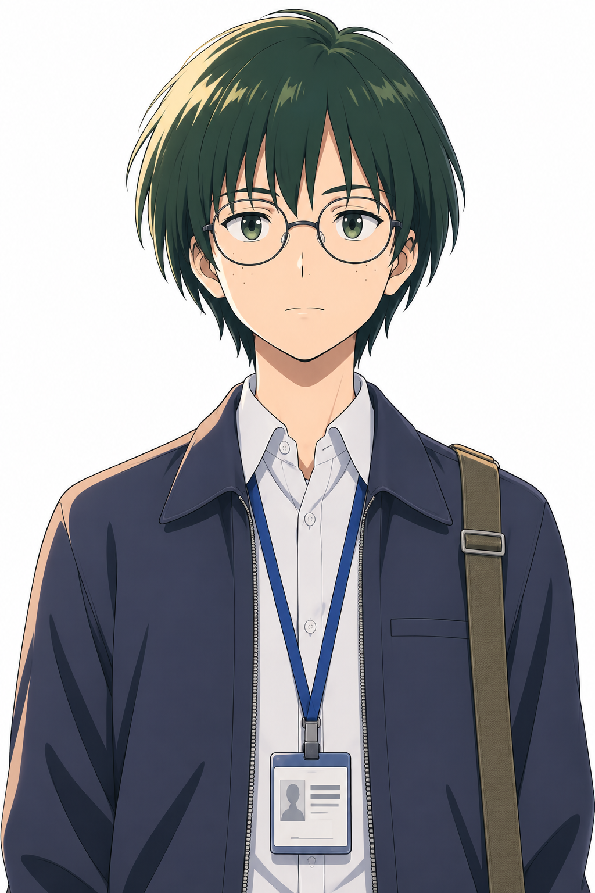

# Local 2D Character Solution — 프로젝트 보이

**그림 속 소년에게 첫 숨을 불어넣어 보세요.** 눈이 마주치면 깜빡이고, 기쁠 땐 웃고, 놀라면 눈을 크게 뜹니다. 내가 쓴 대사나 녹음한 목소리에도 입을 맞춥니다. **프로젝트 보이**는 내 캐릭터를 브라우저에서 만나는 작은 2D 라이브 캐릭터 작업실입니다.

공개 샘플에는 숨쉬기, 네 표정, 시선 이동, 대사 반복 재생과 음성 파일 립싱크가 준비되어 있습니다. 코드를 몰라도 아래 순서대로 실행하면 바로 체험할 수 있습니다.



현재 미리보기는 자체 `.vola`와 기존 `.livliv` 패키지를 엽니다. **Live2D Cubism 재생은 아직 지원하지 않습니다.** Cubism Core나 Live2D 모델은 이 저장소에 없습니다.

## 바로 보기

Node.js 24.x와 Python 3가 필요합니다. 저장소 루트에서:

```sh
npm ci
npm ci --prefix examples/character-preview
npm run build:player
python -m http.server 8765 --bind 127.0.0.1
```

브라우저에서 <http://127.0.0.1:8765/examples/character-preview/>를 엽니다. `build:player`는 고정된 Apache-2.0 LivLiv Player 0.3.0에 놀란 눈 레이어 전환 패치를 적용합니다. 생성 파일은 Git에 넣지 않으며, 원본 라이선스와 변경 고지는 [NOTICE](NOTICE)에 있습니다.

## 샘플 자산과 재제작

- [기준 그림](assets/sample-boy/original.png): 1024×1536 원본.
- [최종 프레임](assets/sample-boy/frames): 기본·깜빡임·입 벌림·기쁨·걱정·놀람·신남, 각 1152×1536. 원본 구도의 좌우에 투명 여백을 더하고 얼굴·안경을 보정한 작업 입력입니다.
- [샘플 모델](assets/sample-boy/sample-boy.vola): 바로 열 수 있는 레이어 모델.

동봉한 프레임에서 모델을 다시 만들려면 Python 의존성을 설치한 뒤 실행합니다. 결과는 `_out/sample/`에 생성되며 동봉 모델을 덮어쓰지 않습니다. 생성 시각 등 메타데이터 때문에 파일 바이트가 다를 수 있습니다.

```sh
python -m pip install -r requirements.txt
npm run build:sample
npm test
```

처음 그림에서 표정 프레임을 제작하는 과정과 안경·놀란 눈 분리 원칙은 [제작 절차](docs/CHARACTER-WORKFLOW.md)에 있습니다. [VOLA 형식](docs/VOLA-FORMAT.md)과 `vola-live` CLI도 문서화했습니다. 새 캐릭터에는 눈·얼굴·앞머리 좌표를 다시 측정해야 합니다.

## 라이선스

자체 코드: Apache-2.0, Copyright 2026 famcoach. LivLiv에서 복사·각색한 부분은 해당 Apache-2.0 원저작권 및 고지를 유지합니다. [LICENSE](LICENSE), [NOTICE](NOTICE), [upstream 기록](third_party/livliv-player/UPSTREAM.md)을 참고하세요.

`assets/sample-boy/`의 그림, 프레임, 모델: **CC BY 4.0**, Copyright 2026 volaven. 저작자 표기와 변경 표시 방법은 [자산 라이선스](assets/sample-boy/LICENSE.md)에 있습니다. 코드 라이선스는 이 자산에 적용되지 않습니다.

`package.json`의 `private: true`는 npm에 실수로 게시하지 않기 위한 설정이며 GitHub 공개 범위와 관계없습니다.
